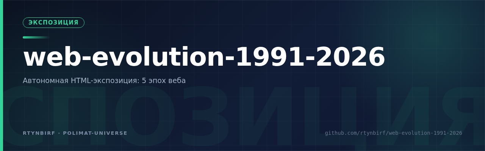

<div align="center">
  
</div>

# Эволюция Веба 1991→2026

Автономная HTML-экспозиция: 35 лет веб-дизайна в одном файле.
Открыл файл — работает. Без сети, без сервера, без внешних запросов.

**Артефакт:** `evolution-web-1991-2026.html` — 267 КБ (273 323 Б), SHA256
`18611ca3b2990324a82e5cbaec2eac9c503c5308c95d32188729dcb5ed39ec81`.
Резерв — `evolution-web-1991-2026.zip` (157 КБ, deflate -9).

## Что внутри

- **Машина времени** — 5 эпох на одной странице, каждая воссоздана вживую:
  1991 (гипертекст CERN) → 1996 (tables) → 2005 (Web 2.0) → 2013 (flat) → 2026 (глассморфизм/бенто);
- **Таймлайн** — 8 верифицированных вех (каждая дата подтверждена источником);
- **ДНК шаблона-2026** — бенто-сетка констант современного шаблона;
- **Здоровье страницы** — контраст WCAG 2.2 ≥ 4.5:1 и APCA Lc ≥ 75 в обеих темах,
  без чистых #000/#FFF (анти-гало), панель комфорта: шрифт чтения (Golos Text),
  эко-режим, живой паспорт страницы (runtime-аудит);
- **Глоссарий** — 10 терминов; **15 источников** в футере (кликабельны);
- **Автономность** — Service Worker + PWA-манифест; 4 вариативных кириллических
  шрифта (Unbounded, Manrope, JetBrains Mono, Golos Text) зашиты base64.

## Размер и дожим

699 КБ → **267 КБ (−62%)**; при gzip-раздаче — 157 КБ.
Приёмы: ресабсет шрифтов под точный чарсет документа (+буфер кириллицы), вырез
GSUB-фич (aalt, ss01–04, frac, subs, …), hinting и BASE; оси `wght` ограничены по
эмпирическому замеру computed-весов (playwright): Unbounded 200–900→500–900,
Manrope 200–800→300–800, JetBrains Mono 100–800→300–800 (Golos не резался —
режим legible наследует веса до 800); CSS — lightningcss (без даунгрейда
синтаксиса), JS — @swc/core (`mangle:false` — inline-хендлеры и строки целы),
чистка HTML (комментарии, отступы, пустые строки).

## Верификация (живой Chromium, file://)

- `document.fonts.check` — **4/4** семьи (включая ленивый Golos в legible-режиме);
- `pageerror` — 0; ошибок консоли — 0; computed-веса — в пределах осевых лимитов;
- внешних `src`/`@import`/`url(http` — **0**; `href="http"` — только 15
  кликабельных источников в футере (не загружаются);
- DOCTYPE→`</html` цел; скриншоты — `screenshots/`.

## Пересборка из клона

```bash
pip install fonttools brotli
python3 tools/squeeze_build.py     # node с lightningcss/@swc/core в NODE_PATH
python3 tools/probe_weights.py evolution-web-1991-2026.html   # playwright
```

Пересборка воспроизводит артефакт **байт-в-байт** (проверено 2026-11-07,
SHA256 совпадает). Ключевое условие детерминизма: `TTFont(...,
recalcTimestamp=False)` — иначе fontTools штампует в `head.modified` время
сборки и шрифты «плывут» при каждом прогоне.

## Мандат

TH-WE-01 (ворклог: rtynbirf/H-PE11-PHOENIX, карта: rtynbirf/repo-doctrine,
06-карта-аккаунта.md). Лицензия — CC-BY-4.0.
